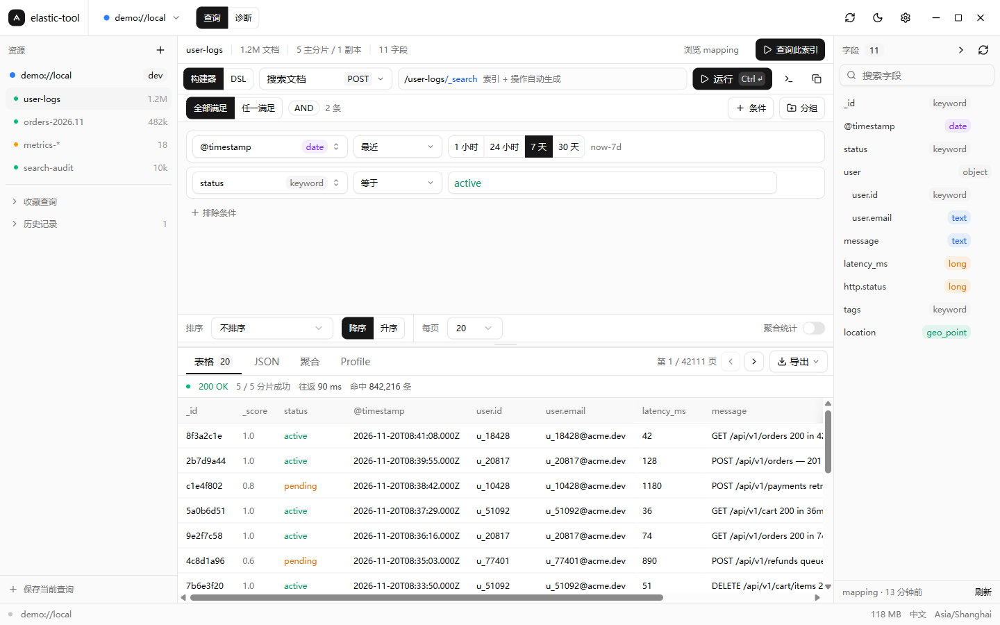
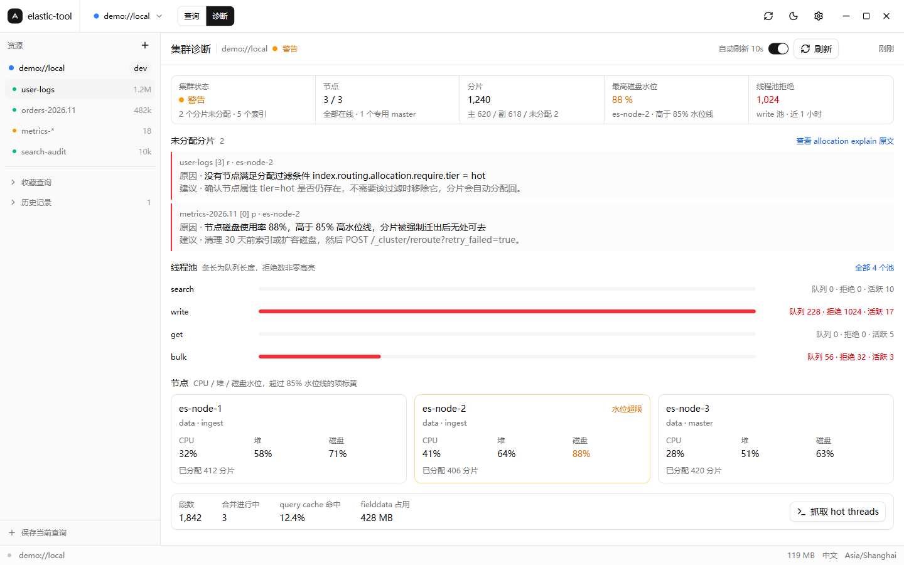
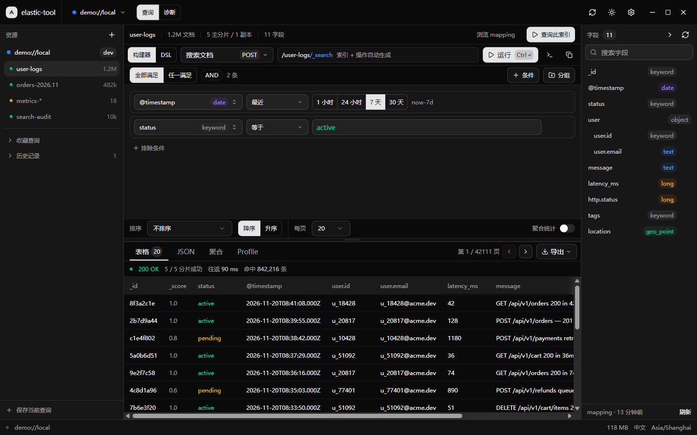
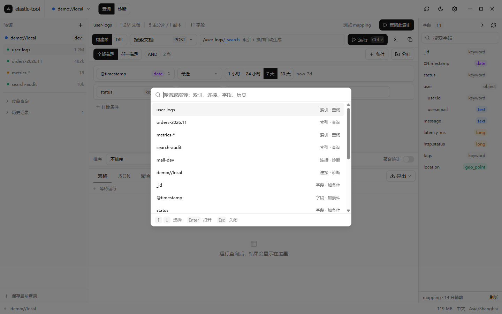
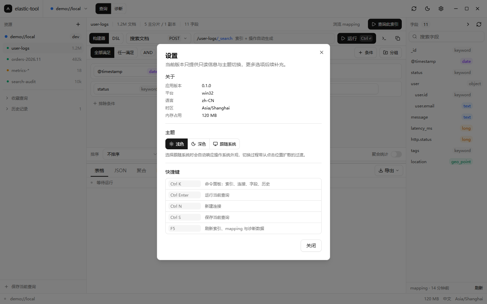

<div align="center">
  
  <h1>elastic-tool</h1>
  <p>Elasticsearch 桌面客户端：索引驱动的查询构建器、DSL 编辑器、结果表格与分页、集群诊断，支持浅色与深色主题。</p>

  <p>
    
    
    
    
    
  </p>
</div>



## 为什么做这个

用 Kibana 的 Dev Tools 写 Elasticsearch 查询，需要记住字段名、操作符和 DSL 语法；用 curl 调接口，又缺少结果表格与集群状态。这个客户端把两件事合在一起：

- 选中索引后，字段来自 mapping，条件行由字段类型决定操作符和值控件，实时编译成 DSL 并校验，运行结果直接在表格里翻页查看。
- 诊断页把分片、线程池、磁盘水位、节点状态集中展示，排查集群问题不用再手写一串 `_cat` 请求。
- 所有请求都在本机主进程发出，凭证用系统钥匙串加密保存。

## 功能

- **查询构建器**：字段选择（可搜索）、类型驱动的操作符矩阵、单值 / 多值 / 区间 / 日期快捷 / 布尔控件、嵌套分组、排除条件、排序、每页条数、聚合开关。
- **编译与校验**：条件树实时编译成 DSL；阻断项禁用运行并给自动修复（如改用 `.keyword`、交换区间端点）；预警项估算扫描耗时；只读连接拦截写操作。
- **DSL 编辑器**：CodeMirror 6、行号、随主题切换的语法高亮，构建器与 DSL 双向切换。
- **结果区**：表格、JSON、聚合、Profile 占位，状态码 / 分片 / 往返耗时 / 命中数，状态字段着色，导出 CSV / JSON / 复制 JSON。
- **结果分页**：默认每页 20 条，可切 20 / 50 / 100，上一页 / 下一页；翻页自动重跑查询，改条件或改每页条数回到第一页。
- **复制成 curl**：运行按钮旁一键复制当前请求的 curl 命令，method、路径、认证方式与自签证书 `-k` 都和实际请求一致。
- **集群诊断**：五张指标卡、未分配分片原因、线程池、节点 CPU / 堆 / 磁盘水位、段与缓存指标、10 秒自动刷新、hot threads。
- **主题**：浅色 / 深色 / 跟随系统，首帧无闪烁，切换带扩散过渡，偏好本地持久化。
- **单工作区**：不做多标签页；切换索引时按「连接 + 索引」保留各自的查询草稿。
- **命令面板（Ctrl K）**：索引、连接、字段加条件、历史跳转。
- **收藏与历史**：保存条件树与选项，按连接隔离，点击恢复。

## 截图

| 查询构建器 | 集群诊断 |
|---|---|
|  |  |

| 深色主题 | 命令面板 |
|---|---|
|  |  |



## 快速开始

要求 Node.js 20+ 与 pnpm 10+。

```bash
git clone https://github.com/nickiilord/elastic-tool.git
cd elastic-tool
pnpm install
pnpm dev
```

首次启动会自动创建一个 `demo://local` 演示连接，不需要真实 Elasticsearch 就能完整体验：构建器、校验、运行、结果表格、分页、诊断页。

连接真实集群：点侧栏顶部的加号，或标题栏连接名下拉菜单里的「新建连接」，填节点地址与认证方式。凭证用系统钥匙串（safeStorage）加密保存，配置文件里只存认证方式的类型。

## 打包

```bash
pnpm dist        # 类型检查 + 构建 + 打包，产物在 dist/
```

| 平台 | 产物 | 说明 |
|---|---|---|
| Windows | `dist/elastic-tool Setup <version>.exe` | NSIS 安装包（x64） |
| macOS | `dist/elastic-tool-<version>.dmg` | 未签名，首次打开需在系统设置里放行 |
| Linux | `dist/elastic-tool-<version>.AppImage` | 需要 FUSE |

只想生成免安装目录、验证打包结果：`pnpm build && pnpm exec electron-builder --dir`，产物在 `dist/win-unpacked/`（mac 为 `dist/mac*/`，Linux 为 `dist/linux-unpacked/`）。

打包配置在 `package.json` 的 `build` 字段：应用图标是 `build/icon.ico` 与 `build/icon.png`，`asar` 开启，源码与测试目录不进包。渲染层依赖全部打进前端 bundle，所以 `dependencies` 里只保留主进程运行时真正需要的包。

当前未配置代码签名与自动更新，`electron-builder` 会跳过签名。

## 脚本

| 命令 | 作用 |
|---|---|
| `pnpm dev` | 启动 Electron 开发模式（渲染层 HMR） |
| `pnpm typecheck` | TypeScript 类型检查 |
| `pnpm test` | Vitest 单元测试（编译、校验、分页、curl 生成） |
| `pnpm build` | 类型检查 + electron-vite 构建到 `out/` |
| `pnpm dist` | 构建并用 electron-builder 打包 |
| `pnpm ui:add <组件>` | 用 shadcn CLI 添加 UI 组件并修正 utils 导入 |

开发启动会经过 `scripts/run-electron-vite.mjs`，它会先清掉环境里的 `ELECTRON_RUN_AS_NODE`，避免 Electron 被当成 Node 运行。

## 目录结构

```
src/
├─ main/                主进程
│  ├─ index.ts          app 生命周期、单实例、窗口创建
│  ├─ window.ts         BrowserWindow、平台标题栏、导航拦截、窗口底色跟随主题
│  ├─ ipc/index.ts      IPC handler、zod 入参校验、只读拦截、主题同步
│  ├─ es/               HTTP 客户端（TLS/认证/超时/取消）、操作执行与计时、curl 命令生成
│  └─ services/         连接与凭证、历史、收藏、schema 缓存、诊断聚合、内存采样、演示数据
├─ preload/index.ts     最小 contextBridge，只暴露业务函数
├─ shared/              主进程与渲染进程共用，纯函数、可单测
│  ├─ types.ts          全部数据契约
│  ├─ operations.ts     操作目录：operationId → method / endpoint / 只读
│  ├─ query/            操作符矩阵、条件树、编译、校验、DSL 解析
│  ├─ format.ts         字节、耗时、数字、时间格式化
│  └─ ipc.ts            IPC 通道名与 preload API 类型
└─ renderer/            渲染进程
   ├─ App.tsx           外框、页面切换、全局快捷键、主题同步
   ├─ components/
   │  ├─ ui/            shadcn/ui 官方组件（button、dialog、popover、command、tabs 等）
   │  ├─ layout/        标题栏、侧栏、状态栏、字段面板
   │  ├─ common/        类型徽标、空态、行内提示
   │  └─ command/       命令面板
   ├─ features/
   │  ├─ workspace/     查询工作区：上下文条、请求栏、构建器/编辑器、结果区
   │  ├─ query-builder/ 条件行、字段选择、操作符选择、值控件、校验面板
   │  ├─ dsl-editor/    CodeMirror 6 封装
   │  ├─ results/       结果视图、耗时条、表格、JSON、聚合、分页
   │  ├─ diagnostics/   集群诊断页
   │  └─ connections/   连接对话框
   ├─ stores/           界面状态（Zustand）与当前查询文档
   ├─ lib/              API 封装、Query Client、主题、数据 hooks
   └─ styles/           globals.css：shadcn 主题变量、Tailwind 入口、动效
docs/                  GitHub Pages 落地页与截图
build/                 应用图标（打包用）
```

分层约定：

- `shared/` 不依赖 Electron、React、Node 内置模块，两端复用。
- `renderer/` 不直接发起网络请求，全部经 preload → 主进程。
- `main/` 不引用渲染层代码。
- 每个功能模块一个目录，组件、hook、类型放在一起。

## UI 组件与主题

界面组件全部由 shadcn/ui 提供，用 CLI 安装到 `src/renderer/components/ui/`，没有手写的仿 shadcn 组件。

- 依赖与路径别名配置在 `components.json`（Tailwind 4、非 RSC、别名指向 `src/renderer`）。
- 添加组件：`pnpm ui:add dialog`。脚本调用 `shadcn add`，并把 registry 生成的 `from "cn"` 导入修正为 `from "@/lib/utils"`。
- 主题是 shadcn 官方的 neutral 主题：`src/renderer/styles/globals.css` 里是标准 CSS 变量（`:root` / `.dark`）与 `@theme inline` 映射。页面只使用 shadcn 颜色变量与 Tailwind 内置调色板，不额外注入自定义设计令牌。
- 深色模式：偏好存 localStorage，`index.html` 的内联脚本在首帧前套用 `.dark` 避免白屏闪烁；主进程同步窗口底色与原生控件外观；切换动画用 View Transition 从点击位置扩散。
- 交互动画：弹层进出、列表进入、面板切换、骨架屏、运行状态进度条，`prefers-reduced-motion` 下全部关闭。

## 快捷键

| 快捷键 | 作用 |
|---|---|
| `Ctrl K` | 命令面板：索引、连接、字段、历史 |
| `Ctrl Enter` | 运行当前查询 |
| `Ctrl N` | 新建连接 |
| `Ctrl S` | 保存当前查询 |
| `F5` | 刷新索引、mapping 与诊断数据 |

## 真实集群验证

已在 Elasticsearch 7.5.1（单节点、无认证）上验证：索引列表、mapping 解析、无条件与带条件的搜索、聚合、集群诊断、只读拦截。这套接口在 7.x 与 8.x 上路径一致，但 8.x / 9.x 尚未实测。

## 已知限制

- 真实集群只在 ES 7.5.1 上验证过，ES 8.x / 9.x 尚未实测。
- 聚合视图只渲染 terms 桶，stats、histogram 等会退化为 JSON 展示。
- Profile 视图仍是占位，待接入真实集群的 profile 响应。
- 撤销栈（Ctrl Z）尚未实现。
- `pnpm dist` 未配置代码签名与自动更新。

## 发布与网页

- **CI**：`.github/workflows/ci.yml` 在 push / PR 到 `main` 时跑类型检查、单测与构建。
- **发布**：推送 `v*` 标签（如 `v0.1.0`）触发 `.github/workflows/release.yml`，在 Windows runner 上打包并上传安装包到 GitHub Release（`--publish never` + `action-gh-release`，不需要额外 token）。
- **GitHub Pages**：`.github/workflows/pages.yml` 把 `docs/` 部署为静态页面（`https://nickiilord.github.io/elastic-tool/`）。工作流通过 `actions/configure-pages` 的 `enablement` 自动启用 Pages；如果仓库策略禁止自动启用，在 Settings → Pages 把 Source 设为 GitHub Actions 后重新运行一次 Pages 工作流即可。

## License

[MIT](LICENSE)
